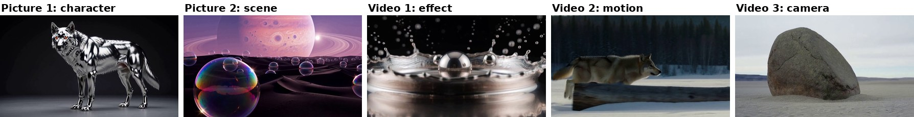
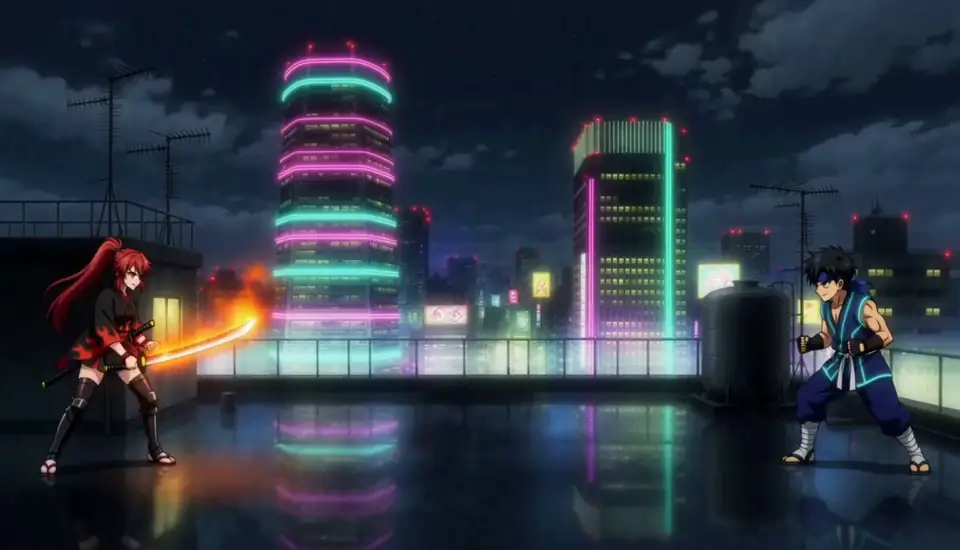
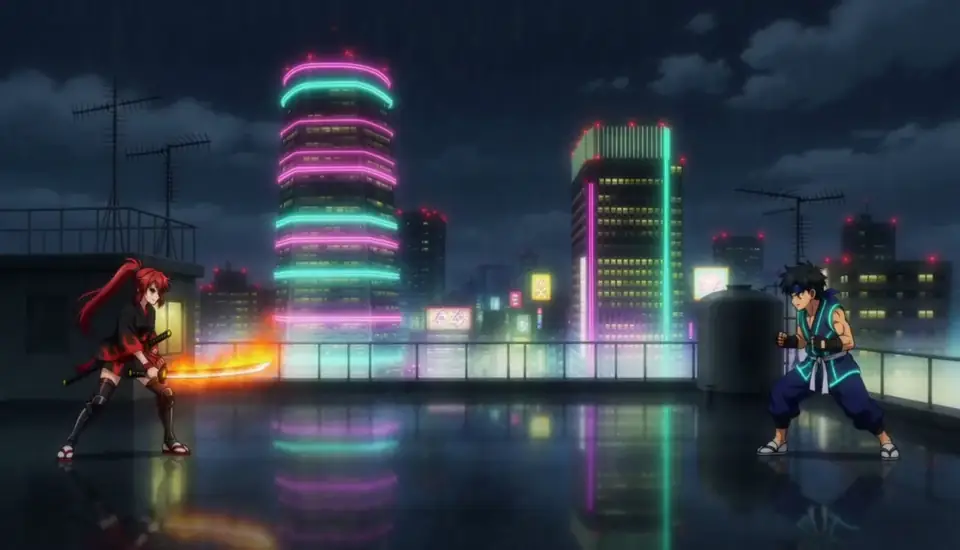
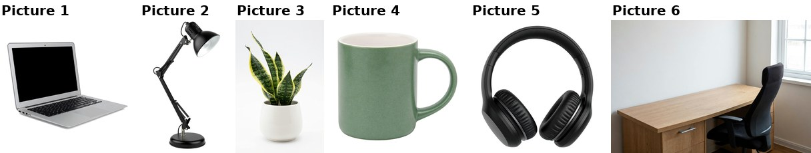

# On-Policy Codec Distillation for Efficient All-in-One Video Generation

Every reference picture or video enters the generator as condition tokens, so their cost grows sharply as the
references gain resolution and frames.

**CodecOPSD** prunes the redundant condition tokens with a video codec and distills a small LoRA on-policy, so that the
pruned model matches the teacher that sees every token.

On average, CodecOPSD drops 66% of the condition tokens over 16 condition types on our own video model (2x faster
denoising), 71.6% on MiniMax-H3 Ref2VA (1.87x faster), and about half on MiniMax-H3-Image (1.36x faster with one
picture, 2.99x with twelve).

The quality stays almost unchanged.

In the extreme setting, denoising becomes up to 8.4x faster.

🎬 [Visualization](#visualization) **|** 🔧 [Installation](#installation) **|** 🚀 [Inference](#inference)

## <a name="visualization"></a> Visualization 🎬

Teacher = the released model with every condition token. CodecOPSD = the same model + the CodecOPSD LoRA, after codec
pruning. Same references, prompt, seed, and sampler; the times are denoising times.

### MiniMax-H3 Ref2VA (reference-to-video generation)

**Silver wolf in a dusk desert**: 2 pictures + 3 videos -> 1 video (Pika H3 Flex, distilled 6 steps), 768 x 1344, 243
frames, 1x B200



| Teacher (all tokens) | CodecOPSD (8.4x faster): condition tokens 232,064 -> 24,153 (-90%) |
|:---:|:---:|
|  |  |

**Anime duel in two shots**: 3 pictures + 3 videos -> 1 video (Pika H3 Flex, distilled 6 steps), 768 x 1344, 124
frames, 1x B200


| Teacher (all tokens), 396 s | CodecOPSD, 61.0 s (6.5x faster): condition tokens 133,392 -> 22,329 (-83%) |
|:---:|:---:|
|  |  |

### MiniMax-H3-Image (reference-to-image generation)

**Desk setup with edits**: "Put the laptop \<Picture 1\>, lamp \<Picture 2\>, plant \<Picture 3\>, mug \<Picture 4\> and
headphones \<Picture 5\> on the desk in \<Picture 6\> in the evening. The mug stands on the left part of the desk, in
front of the lamp. The lamp is on and casts warm light on the desk. Print a big white "CodecOPSD" logo on the mug that
wraps around its curved side." -> image (6 steps), 1664 x 2496, 1x B200



| Teacher (all tokens), 17.5 s | CodecOPSD, 6.7 s (2.6x faster): reference tokens 17,280 -> 3,648 (-79%) |
|:---:|:---:|
|  |  |

### Method

Codec pruning drops the redundant condition tokens of every reference before the DiT, and the student LoRA is distilled
on its own rollouts from the teacher, which sees every condition token:

<p align="center">

</p>

:star: **If you like CodecOPSD, please help ⭐⭐star⭐⭐ this repo. Thanks!** :hugs:

## <a name="installation"></a> Installation 🔧

Linux x86_64, Python 3.12, and an NVIDIA GPU with 80 GB or more (141 GB or more keeps every model on the GPU).

```bash
git clone https://github.com/Kiteretsu77/CodecOPSD.git && cd CodecOPSD
conda create -n codecopsd python=3.12 -y && conda activate codecopsd
pip install -e .                        # PyTorch 2.8, diffusers 0.43, transformers 5.14.1
bash scripts/build_codec_reader.sh      # the H.264 reader of codec pruning (FFmpeg 5.1 + a patch), about a minute
```

- The reader build needs curl, bzip2, patch, a C compiler, make, and the Python headers
  (`sudo apt-get install -y curl bzip2 patch build-essential python3-dev`).
- `transformers` 5.14.1 and `imageio-ffmpeg` 0.7.0 are pinned: the LoRAs were trained on that text encoder's vision
  features, and the x264 build is part of codec pruning.
- The models download on first use into `models/` (released models from the Hugging Face Hub at pinned revisions);
  `python -m codecopsd.download` downloads them ahead (`--dry-run` lists them and their sizes).

## <a name="inference"></a> Inference 🚀

**Video:** MiniMax-H3 $\color{#4493F8}{\textsf{Ref2VA}}$ (reference-to-video generation)

```bash
python inference/generate.py minimax_h3_ref2va --prompt-file prompt.txt --reference man.jpg --reference street.jpg \
    --reference camera.mp4 --out out.mp4                             # <Picture 1>, <Picture 2>, <Video 1> in the prompt
```

<details>
<summary>Python, settings</summary>

```python
import torch
from diffusers.utils import export_to_video
from codecopsd import MiniMaxH3CodecOPSDPipeline
from codecopsd.pipelines.minimax_h3_ref2va import load_reference

pipe = MiniMaxH3CodecOPSDPipeline.from_minimax_h3("models/MiniMax-H3-Ref2VA", text_encoder_fp8="fp8")  # sampler: Pika H3 Flex, 6 steps
pipe.load_condition_lora("models/codecopsd_minimax_h3_ref2va.safetensors")
pipe.enable_model_cpu_offload()

prompt = "The man from <Picture 1> walks down the street of <Picture 2>; the camera follows him as in <Video 1>."
references = [load_reference(f) for f in ["man.jpg", "street.jpg", "camera.mp4"]]
video = pipe(prompt, references, generator=torch.Generator().manual_seed(42)).frames[0]  # 480 x 832, 124 frames
export_to_video(video, "out.mp4", fps=24)
```

| Setting | Flag | Default |
|---|---|---|
| Output size, height x width | `--height`, `--width` | 480 x 832 (480p); 768 x 1344 = 768p |
| Frames, 24 fps, 17n + 5 | `--frames` | 124 (5.2 s), up to 243 |
| Seed | `--seed` | 42 |
| Sampler | `--sampler` | `pika`: Pika H3 Flex, 6 steps (`fasth3`: 8 steps, `base`: 50 steps) |
| Video references | `--video-drop` | `0.7`: drop 70 % |
| Codec thresholds, videos | `--video-thresholds MOTION_PX RESIDUAL` | 5.0 1.0 |
| Codec thresholds, pictures | `--picture-thresholds MOTION_PX RESIDUAL` | 4.0 1.5 |
| Text encoder pruning | `--vlm-drop`, `--vlm-scale` | pictures: the thresholds x 0.25; videos: the transformer's tokens |
| Text encoder weights | `--text-encoder` | `fp8` (converted from the bf16 release at load) |
| Attention | `--attention` | `auto`: cuDNN on H100 / H200 / B200, SDPA on A100 |
| GPU placement | `--offload` | `auto`: every model on the GPU from 150 GB, else one at a time |
| Kept tokens | `--save-masks` | off: the codec pruning masks of the references as a .npz |
| Mode | `--mode` | `compress`: CodecOPSD (`baseline`: the teacher, every token; `extreme`: drop 90 % of the video tokens) |

</details>

**Image:** MiniMax-H3-Image (reference-to-image generation)

```bash
python inference/generate.py minimax_h3_image --prompt "Put the lamp <Picture 1> on the desk in <Picture 2>." \
    --image lamp.jpg --image desk.jpg --out out.png
```

<details>
<summary>Python, settings</summary>

```python
import torch
from PIL import Image
from codecopsd import MiniMaxH3ImageCodecOPSDPipeline

pipe = MiniMaxH3ImageCodecOPSDPipeline.from_minimax_h3_image("models/MiniMax-H3-Image", text_encoder_fp8="fp8")
pipe.load_condition_lora("models/codecopsd_minimax_h3_image.safetensors")
pipe.enable_model_cpu_offload()

prompt = "Put the lamp <Picture 1> on the desk in <Picture 2>."
image = pipe(prompt, [Image.open("lamp.jpg"), Image.open("desk.jpg")],
             generator=torch.Generator().manual_seed(42)).images[0]  # the first picture's aspect ratio, 2048 x 2048 area
image.save("out.png")
```

| Setting | Flag | Default |
|---|---|---|
| Output size, height x width | `--height`, `--width` | the first picture's aspect ratio on the 2048 x 2048 area |
| Steps | | the released 6-step grid |
| Seed | `--seed` | 42 |
| Codec thresholds, pictures | `--picture-thresholds MOTION_PX RESIDUAL` | 4.0 1.5 (the residual threshold falls with the short side above 1024 px) |
| Text encoder pruning | `--vlm-drop`, `--vlm-scale` | the picture thresholds x 0.25 |
| Text encoder weights | `--text-encoder` | `fp8` (converted from the bf16 release at load) |
| Attention | `--attention` | `auto`: cuDNN on H100 / H200 / B200, SDPA on A100 |
| GPU placement | `--offload` | `auto`: every model on the GPU from 150 GB, else one at a time |
| Kept tokens | `--save-masks` | off: the codec pruning masks of the references as a .npz |
| Mode | `--mode` | `compress`: CodecOPSD (`baseline`: the teacher, every token) |

</details>

<details>
<summary>Model weights and storage</summary>

The first run of a model downloads what it needs into `models/` in the repository folder: the released models from the
Hugging Face Hub at pinned revisions and the CodecOPSD LoRA. Later runs reuse everything. `models/` can be a symlink to
a larger disk.

| Model | Downloads |
|---|---|
| Video | `MiniMax-H3-Ref2VA/` 143.4 GB (MiniMaxAI/MiniMax-H3 with only its Ref2VA transformer, VAE and text encoder), `Pika-H3-Flex/` 2.8 GB, `codecopsd_minimax_h3_ref2va.safetensors` (TODO: Hugging Face) |
| Image | `MiniMax-H3-Image/` 68.6 GB without its text encoder, which is linked from the video folder when both are downloaded, `codecopsd_minimax_h3_image.safetensors` (TODO: Hugging Face) |

</details>

<details>
<summary>Acceleration in this repository</summary>

Every item is built into this repository and on by default, stacked on codec pruning:

- Codec pruning on the CPU, in parallel with the VAE encode: no added time
- CodecOPSD LoRA on the kept condition tokens
- Text encoder (VLM) pruning: it reads the kept vision tokens
- Few-step sampler: Pika H3 Flex, 6 steps (`--sampler fasth3`: FastH3 Omni 8-Step)
- FP8 text encoder
- Video VAE decoder in bf16
- AdaLN as per-timestep tables: less GPU memory, same output
- Attention kernel per GPU: cuDNN on H100 / H200 / B200, SDPA on A100
- GPU placement: every model resident from 150 GB, else model offload or block streaming (`--offload`)

| `--sampler` | Files (next to `MiniMax-H3-Ref2VA/`) | Steps |
|---|---|---|
| `pika` (default) | [Pika H3 Flex](https://huggingface.co/Pika-Labs/Pika-H3-Flex) `Pika-H3-Flex/ref2va/adapter.safetensors` | 6 |
| `fasth3` | [FastH3 Omni 8-Step](https://huggingface.co/FastVideo/FastVideo-FastH3-Omni-8-Step-V1) `FastH3-Omni-8step/` | 8 |
| `base` (baseline) | none | 50 |

</details>

<details>
<summary>Repository layout</summary>

```
inference/
  generate.py                     one-line inference of every model
  cli/                            each model's command line: minimax_h3_ref2va.py, minimax_h3_image.py
  load.py                         the models, building a pipeline, offload (shared)
  utils.py                        dropped-token counts, run summary lines
src/codecopsd/
  codec_gazer/                    codec pruning: drop_mask, submit_gaze; its H.264 reader (C), the FFmpeg 5.1 patch, README
  configs/                        every setting, commented (codec_gazer.yaml: the thresholds and the priority drop)
  download.py                     the first-use download into models/
  attention.py                    attention kernels of the transformer
  models/                         condition-row LoRA transformers, FP8 linears
  pipelines/minimax_h3_ref2va/    Ref2VA (reference to video): MiniMaxH3CodecOPSDPipeline, few-step samplers, VLM drop
  pipelines/minimax_h3_image/     reference to image: MiniMaxH3ImageCodecOPSDPipeline
scripts/build_codec_reader.sh     builds the H.264 reader of codec pruning
tests/test_drop_mask.py           drop_mask on synthetic inputs (CPU, about 20 s)
```

</details>
