<div align="center">
  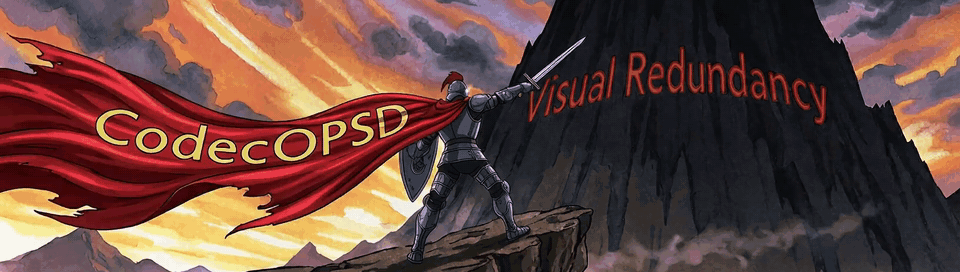
</div>

<h1 align="center">On-Policy Codec Distillation<br>for Efficient All-in-One Video Generation</h1>

<p align="center">
<a href="https://kiteretsu77.github.io/BoyangWang/">Boyang Wang</a>,
<a href="https://kmatzen.com/">Kevin Blackburn-Matzen</a>,
<a href="https://research.adobe.com/person/oindrila-saha/">Oindrila Saha</a>,
<a href="https://mgadelha.me/">Matheus Gadelha</a>,
<a href="https://www.cs.virginia.edu/~zc3bp/">Zezhou Cheng</a>
</p>

<p align="center">
<a href="#"></a>
<a href="https://kiteretsu77.github.io/CodecOPSD_website/"></a>
<a href="https://x.com/BoyangWang7"></a>
<a href="https://github.com/Kiteretsu77/CodecOPSD"></a>
</p>

<p align="center">
<a href="https://huggingface.co/HikariDawn/CodecOPSD-H3-Ref2VA"></a>
<a href="https://huggingface.co/HikariDawn/CodecOPSD-H3-Image"></a>
<a href="https://huggingface.co/spaces/HikariDawn/CodecOPSD-H3-Ref2VA"></a>
<a href="https://huggingface.co/spaces/HikariDawn/CodecOPSD-H3-Image"></a>
</p>

Sequence-wise generators (MiniMax-H3 Ref2VA, MiniMax-H3-Image, Qwen-Image 2.1, FLUX 3 Image Klein) append every
reference picture or video to the input token sequence, so the token cost grows sharply as more references are added.
We propose **CodecOPSD** to prune the redundant condition tokens with a video codec, and we train a small LoRA on the
kept tokens via on-policy self-distillation.

On average, CodecOPSD drops about 70% of the condition tokens on MiniMax-H3 Ref2VA with almost unchanged quality and
1.87x faster denoising, and up to 8.4x faster with more conditions (three reference videos, higher-resolution
references, more frames, and a higher drop rate).

On MiniMax-H3-Image, it drops about 65% of the reference tokens and makes denoising about 2x faster. More cases are on
the <a href="https://kiteretsu77.github.io/CodecOPSD_website/" target="_blank" rel="noopener">project page</a>.

🎬 [Visualization](#visualization) **|** 🔥 [News](#news) **|** 🔧 [Installation](#installation) **|** ⚡ [Quickstart](#quick_start) **|** 🚀 [Inference](#inference) **|** 🧩 [Codec Pruning](#codec_pruning) **|** 🏋️ [Train](#training) **|** 📜 [License](#license)

⭐ **If you like CodecOPSD, please help ⭐⭐star⭐⭐ this repo. Thanks!** 🤗

## <a name="visualization"></a> Visualization 🎬

**Teacher** = the released model, every condition token.<br>
**+ CodecOPSD** (student) = the same model with codec pruning and the CodecOPSD LoRA.<br>
Everything else is the same; only the number of condition tokens differs. Times are denoising times.

### MiniMax-H3 Ref2VA (reference-to-video generation)

**Silver wolf in a dusk desert**: 2 pictures + 3 videos → 768p, 243 frames, Pika H3 Flex 6 steps, B200.<br>
<sub>Extreme setting: 90% of the three videos' tokens pruned, in the DiT and in the VLM.</sub>

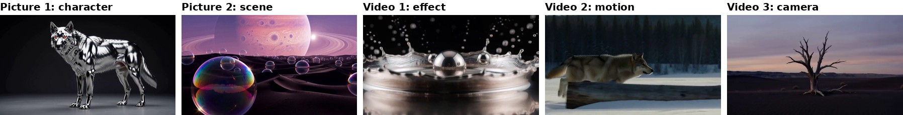

| Teacher (all tokens)<br><sub>1013 s</sub> | **+ CodecOPSD**: **8.4x faster**<br><sub>121 s · tokens 232k → 24k (−90%) · VLM 47.7k → 11.0k (−77%)</sub> |
|:---:|:---:|
|  |  |

**Anime duel in two shots**: 3 pictures + 3 videos → 768p, 124 frames, Pika H3 Flex 6 steps, H200.<br>
<sub>Extreme setting: 90% of the two effect videos' tokens pruned, in the DiT and in the VLM.</sub>

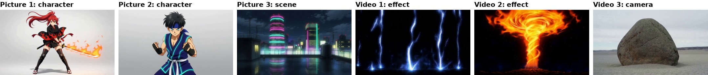

| Teacher (all tokens)<br><sub>731 s</sub> | **+ CodecOPSD**: **6.8x faster**<br><sub>108 s · tokens 133k → 22k (−83%)</sub> |
|:---:|:---:|
| 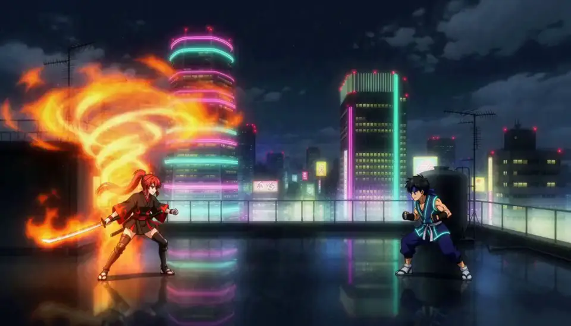 | 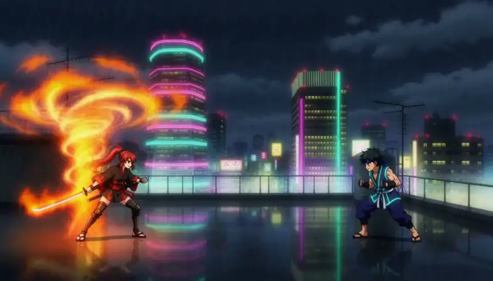 |

<a name="gallery"></a>**H3 Ref2VA Gallery** (click to open it)

<a href="https://kiteretsu77.github.io/CodecOPSD_website/#gallery" target="_blank" rel="noopener"></a>

<br>

### MiniMax-H3-Image (reference-to-image generation)

**6 references -> 1 desk scene**: 6 pictures -> image (distilled 6 steps), 1664 x 2496, 1x H200. Put the "laptop",
"lamp", "plant", "mug", and "headphones" onto the "desk" in the evening, in the same camera view, with a "CodecOPSD"
logo printed on the mug.

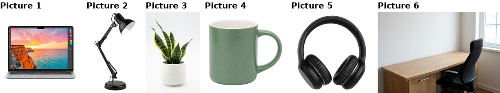

| Teacher (all tokens)<br><sub>29.7 s</sub> | **+ CodecOPSD**: **3.1x faster**<br><sub>9.5 s · tokens 17.3k → 4.0k (−77%)</sub> |
|:---:|:---:|
| 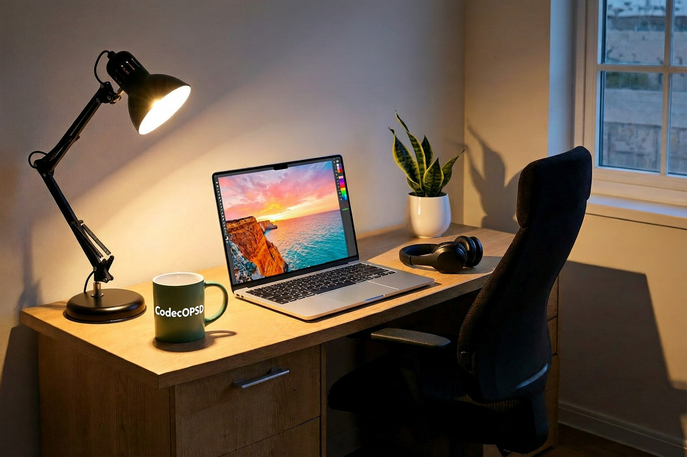 | 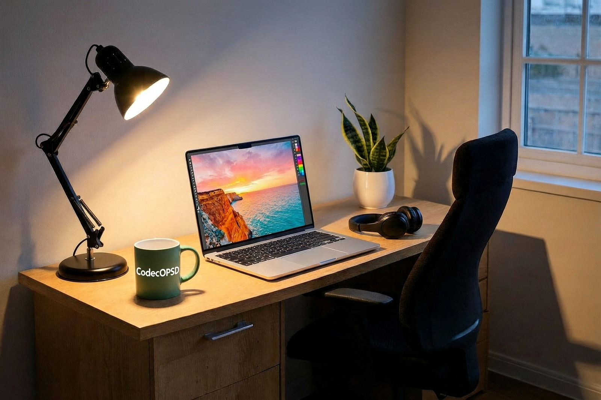 |

**16 references -> 1 group photo**: 16 pictures -> image (distilled 6 steps), 2048 x 3072, 1x H200

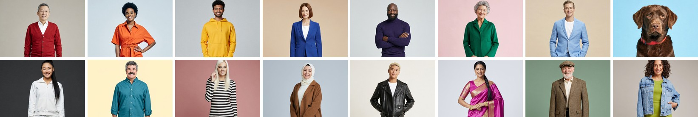

| Teacher (all tokens)<br><sub>302.9 s</sub> | **+ CodecOPSD**: **7.6x faster**<br><sub>39.6 s · tokens 98.6k → 17.1k (−83%)</sub> |
|:---:|:---:|
| 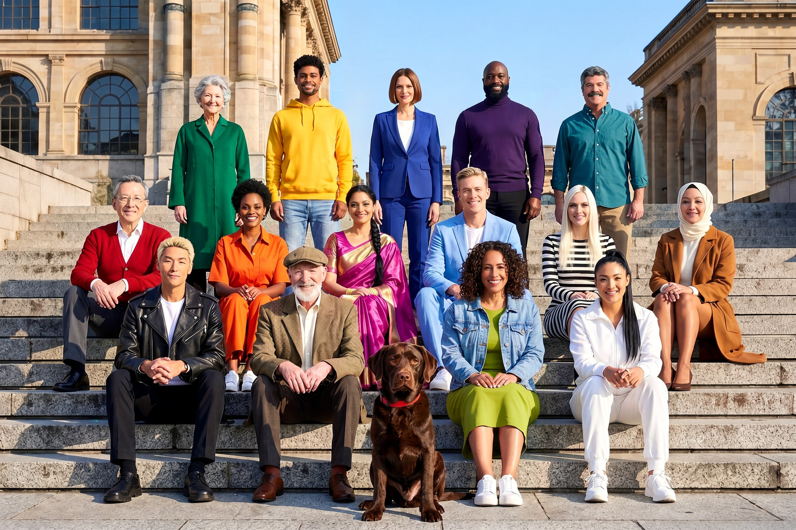 | 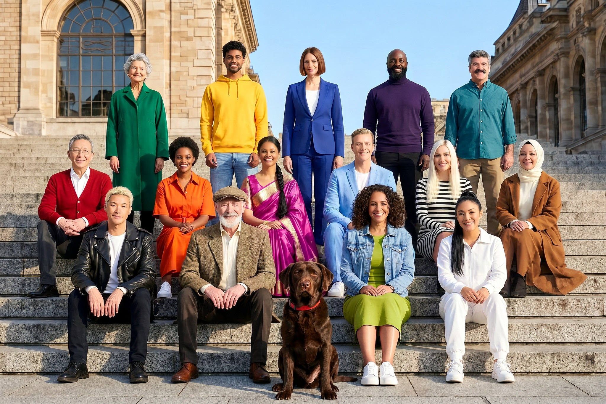 |

<a name="gallery_image"></a>**H3-Image Gallery** (click to open it)

<a href="https://kiteretsu77.github.io/CodecOPSD_website/#gallery-h3img" target="_blank" rel="noopener"></a>

<br>

### 16 conditions, mixed together

<p align="center">
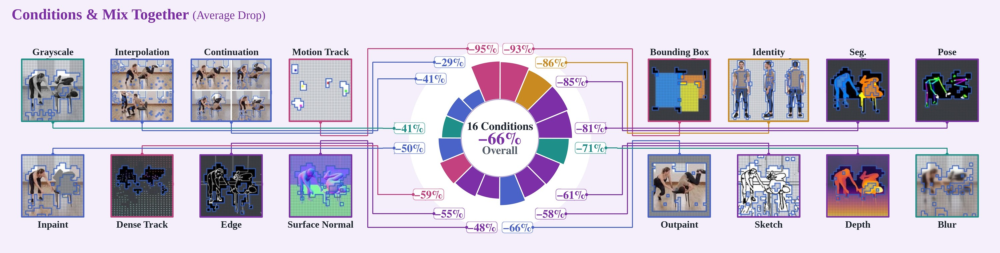
</p>

### Method

Codec pruning drops the redundant condition tokens of every reference before the DiT, and the student LoRA is distilled
on its own rollouts from the teacher, which sees every condition token:

<p align="center">
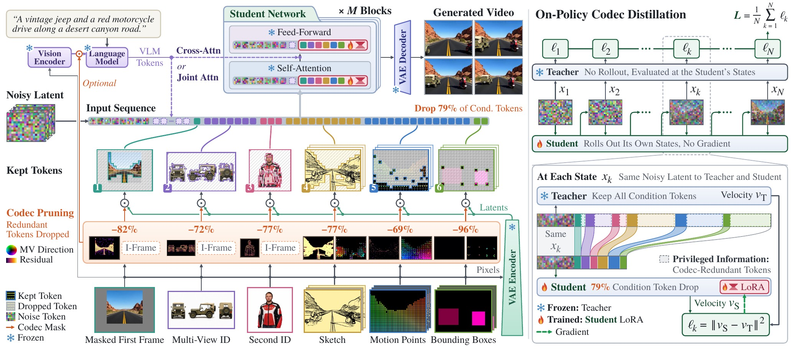
</p>

## <a name="news"></a> News 🔥

- **2026-11**: Code release: inference and training of CodecOPSD for MiniMax-H3 Ref2VA and MiniMax-H3-Image, one-line
  inference, and Gradio demos.
- **2026-11**: [Project page](https://kiteretsu77.github.io/CodecOPSD_website/) with the Ref2VA and image galleries.
- **2026-11**: Models on Hugging Face ([H3-Ref2VA](https://huggingface.co/HikariDawn/CodecOPSD-H3-Ref2VA),
  [H3-Image](https://huggingface.co/HikariDawn/CodecOPSD-H3-Image)) and Hugging Face Spaces
  ([H3-Ref2VA](https://huggingface.co/spaces/HikariDawn/CodecOPSD-H3-Ref2VA),
  [H3-Image](https://huggingface.co/spaces/HikariDawn/CodecOPSD-H3-Image)).
- [ ] Release the paper (arXiv)
- [ ] Check the training code
- [ ] Extend to Cosmos 3 Nano
- [ ] Extend to Qwen-Image 2.1
- [ ] Extend to FLUX 3 Image Klein

## <a name="installation"></a> Installation 🔧

Linux x86_64, Python 3.12, and an NVIDIA GPU with 80 GB or more (141 GB or more keeps every model on the GPU). On a
12 to 32 GB GPU with 64 GB of CPU memory, optimized for the RTX 3090, 4090 and 5090, video runs at 480p: see
[Consumer GPUs](#consumer_gpus).

```bash
git clone https://github.com/Kiteretsu77/CodecOPSD.git && cd CodecOPSD
conda create -n codecopsd python=3.12 -y && conda activate codecopsd
pip install -e ".[app]"                 # PyTorch 2.8, diffusers 0.43, transformers 5.14.1; [app] adds Gradio
```

- `transformers` 5.14.1 and `imageio-ffmpeg` 0.7.0 are pinned: the LoRAs were trained on that text encoder's vision
  features, and the x264 build is part of codec pruning.
- The models download on first use (see [Quick Start](#quick_start)); `python -m codecopsd.download` downloads them ahead
  (`--dry-run` lists them and their sizes).

## <a name="quick_start"></a> Quick Start ⚡

Every demo prints a public link when it starts: open it and click an example. The first launch downloads the models.

**Video:** MiniMax-H3 $\color{#4493F8}{\textsf{Ref2VA}}$ (reference-to-video generation) with
[Pika H3 Flex](https://huggingface.co/Pika-Labs/Pika-H3-Flex), 6 steps

```bash
python app.py ref2va
```

**Image:** MiniMax-H3 $\color{#F0883E}{\textsf{Image}}$ (reference-to-image generation)

```bash
python app.py ref2image
```

<a name="consumer_gpus"></a>**Consumer GPUs:** MiniMax-H3 $\color{#4493F8}{\textsf{Ref2VA}}$, optimized for RTX 3090, 4090 and 5090

```bash
python app.py ref2va_extreme
```

What the extreme app changes from the standard one ([docs/consumer_gpus.md](docs/consumer_gpus.md)):

- **Transformer:** [HyperFlow H3 Flash](https://huggingface.co/VideoRebirthAI/hyperflow-h3-flash) (INT8 and low rank,
  16 GB), 4 steps, instead of MiniMax-H3 with Pika H3 Flex, 6 steps; the same CodecOPSD LoRA.
- **Reference encoder:** TAEH3, a small encoder, instead of the released VAE encoder; the released VAE still decodes.
- **Reference pictures:** read at their own short edge within 1024 to 2048 px (the standard app: always 2048).
- **GPU memory:** one plan per card size (12, 16, 24, 32 GB), picked automatically; only the running model sits on the
  GPU, and on 24 GB and smaller cards Flash's blocks are streamed in one by one.
- **CPU memory:** the waiting models are page-locked; with less than 64 GB, the VLM is read from the page cache.
- **Kernels:** the attention, INT8 and FP8 kernels are chosen for each RTX generation (30, 40, 50).

<details>
<summary>Model weights and storage, demo options</summary>

| Demo | GPU | CPU memory | Disk |
|---|---|---|---|
| Video | 80 GB or more | 128 GB | 115 GB |
| Image | 80 GB or more | 128 GB | 104 GB |
| Consumer GPUs | 12 to 32 GB | 64 GB | 62 GB |

- Weights go to `models/` (a symlink to a larger disk works): the released models at pinned revisions, our LoRAs and
  examples from [CodecOPSD-H3-Ref2VA](https://huggingface.co/HikariDawn/CodecOPSD-H3-Ref2VA) and
  [CodecOPSD-H3-Image](https://huggingface.co/HikariDawn/CodecOPSD-H3-Image). All three demos share the FP8 VLM and
  take 203 GB together; `python -m codecopsd.download --dry-run` lists every file.
- `--no-share`: a local page only; `--no-download`: no downloads.
- "Where the time went" under each result lists the stages; outputs/app/stats.jsonl keeps one line per run.

</details>

## <a name="inference"></a> Inference 🚀

**Video:** MiniMax-H3 $\color{#4493F8}{\textsf{Ref2VA}}$ (reference-to-video generation)

```bash
# a bundled example -> outputs/
python inference/generate.py minimax_h3_ref2va --example dog_frisbee

# your own inputs: <Picture 1>, <Picture 2>, <Video 1> in the prompt are the references in order
python inference/generate.py minimax_h3_ref2va --prompt-file prompt.txt \
    --reference man.jpg --reference street.jpg --reference camera.mp4 --out out.mp4
```

On a 12 to 32 GB GPU: `python inference/generate.py h3_flash_ref2va` ([Consumer GPUs](docs/consumer_gpus.md)).

<details>
<summary>Python, settings, bundled examples</summary>

```python
import torch
from diffusers.utils import export_to_video
from codecopsd import MiniMaxH3CodecOPSDPipeline
from codecopsd.pipelines.minimax_h3_ref2va import load_reference

pipe = MiniMaxH3CodecOPSDPipeline.from_minimax_h3(
    "models/MiniMax-H3-Ref2VA", text_encoder_fp8="fp8",
    text_encoder_path="models/MiniMax-H3-ModelOpt-Mixed9-Dynamic-FP8/Ref2VA/text_encoder")
pipe.load_condition_lora("HikariDawn/CodecOPSD-H3-Ref2VA", weight_name="codecopsd_minimax_h3_ref2va.safetensors")
pipe.enable_model_cpu_offload()

video = pipe(
    prompt="The golden retriever from <Picture 1> chases and catches a flying red frisbee on the park lawn of "
           "<Picture 2>, running like the dog in <Video 1>. The camera tracks the dog.",
    references=[load_reference(f) for f in ["dog.jpg", "park.jpg", "dog_running.mp4"]],
    generator=torch.Generator().manual_seed(42),
).frames[0]
export_to_video(video, "output.mp4", fps=24)
```

| Setting | Flag | Default (as the demo) |
|---|---|---|
| Output size, height x width | `--height`, `--width` | 480 x 832 (480p); 768 x 1344 = 768p |
| Frames, 24 fps, 17n + 5 | `--frames` | 124 (5.2 s), up to 243 |
| Seed | `--seed` | 42 |
| Sampler | `--sampler` | `pika`: Pika H3 Flex, 6 steps (`fasth3`: 8 steps, `flash`: HyperFlow H3 Flash, 6 steps, `base`: 50 steps) |
| Video references | `--video-drop` | `0.7`: drop 70 % (recommended) |
| Codec thresholds, videos | `--video-thresholds MOTION_PX RESIDUAL` | 5.0 1.0 |
| Codec thresholds, pictures | `--picture-thresholds MOTION_PX RESIDUAL` | 4.0 1.5 |
| Text encoder pruning | `--vlm-drop`, `--vlm-scale` | pictures: the thresholds x 0.25; videos: the transformer's tokens |
| Text encoder weights | `--text-encoder` | `fp8` |
| Attention | `--attention` | `auto`: cuDNN on H100 / H200 / B200, SDPA on A100 |
| GPU placement | `--offload` | `auto`: every model on the GPU from 150 GB (`flash`: 64 GB), else one at a time (`flash`: `pinned`) |
| GPU memory plan | `--gpu-memory` | the GPU's own; `16`, `24` or `32` plans for (and caps the process to) that card ([Consumer GPUs](#consumer_gpus)) |
| Time per stage | `--stats` | off: prints where the seconds went, stage by stage |
| Mode | `--mode` | `compress`: CodecOPSD (`baseline`: the teacher, every token) |

Bundled video examples: every folder in `assets/examples/minimax_h3_ref2va/` (`dog_frisbee`, `dolly_zoom_desert`, `wolf`,
`candy`, `deep_sea`, `qinglong`, `blanket`, ...).

</details>

**Image:** MiniMax-H3 $\color{#F0883E}{\textsf{Image}}$ (reference-to-image generation)

```bash
# a bundled example -> outputs/
python inference/generate.py minimax_h3_image --example desk_setup_edit

# your own inputs: <Picture 1>, <Picture 2> in the prompt are the images in order
python inference/generate.py minimax_h3_image --prompt "Put the lamp <Picture 1> on the desk in <Picture 2>." \
    --image lamp.jpg --image desk.jpg --out out.png
```

<details>
<summary>Python, settings, bundled examples</summary>

```python
import torch
from PIL import Image
from codecopsd import MiniMaxH3ImageCodecOPSDPipeline

pipe = MiniMaxH3ImageCodecOPSDPipeline.from_minimax_h3_image(
    "models/MiniMax-H3-Image", text_encoder_fp8="fp8",
    text_encoder_path="models/MiniMax-H3-ModelOpt-Mixed9-Dynamic-FP8/Ref2VA/text_encoder")
pipe.load_condition_lora("HikariDawn/CodecOPSD-H3-Image", weight_name="codecopsd_minimax_h3_image.safetensors")
pipe.enable_model_cpu_offload()

image = pipe(
    prompt="Put the lamp <Picture 1> on the desk in <Picture 2>.",
    images=[Image.open("lamp.jpg"), Image.open("desk.jpg")],
    generator=torch.Generator().manual_seed(42),
).images[0]
image.save("output.png")
```

| Setting | Flag | Default (as the demo) |
|---|---|---|
| Output size, height x width | `--height`, `--width` | the first picture's aspect ratio on the 2048 x 2048 area |
| Steps | | the released 6-step grid |
| Seed | `--seed` | 42 |
| Codec thresholds, pictures | `--picture-thresholds MOTION_PX RESIDUAL` | 4.0 1.5 (the residual threshold falls with the short side above 1024 px) |
| Text encoder pruning | `--vlm-drop`, `--vlm-scale` | the picture thresholds x 0.25 |
| Text encoder weights | `--text-encoder` | `fp8` |
| Attention | `--attention` | `auto`: cuDNN on H100 / H200 / B200, SDPA on A100 |
| GPU placement | `--offload` | `auto`: every model on the GPU from 150 GB, else one at a time |
| Mode | `--mode` | `compress`: CodecOPSD (`baseline`: the teacher, every token) |

Bundled image examples: every folder in `assets/examples/minimax_h3_image/` (`desk_setup_edit`, `product_poster`,
`farm_barn`, `lineart_to_photo`, ...).

</details>

### Extra acceleration merged in this repo

<details>
<summary>Every extra acceleration (on by default), few-step samplers</summary>

On top of CodecOPSD (codec pruning and the CodecOPSD LoRA), every item below is merged into this repo and on by default:

- Text encoder (VLM) pruning: it reads the kept vision tokens
- Few-step sampler: Pika H3 Flex, 6 steps (`--sampler fasth3`: FastH3 Omni 8-Step)
- FP8 text encoder
- Video VAE decoder in bf16
- AdaLN as per-timestep tables: less GPU memory, same output
- Attention kernel per GPU: cuDNN on H100 / H200 / B200, SDPA on A100
- GPU placement: every model resident from 150 GB, else model offload or block streaming (`--offload`)
- 16-32 GB GPUs (`--sampler flash`): HyperFlow H3 Flash in place of the released transformer (the CodecOPSD LoRA runs
  on its 49 blocks unchanged), one model on the GPU at a time from page-locked memory, the text encoder and (24 / 16 GB)
  Flash's blocks streamed in while they run ([Consumer GPUs](docs/consumer_gpus.md))

| `--sampler` | Files (next to `MiniMax-H3-Ref2VA/`) | Steps |
|---|---|---|
| `pika` (default) | [Pika H3 Flex](https://huggingface.co/Pika-Labs/Pika-H3-Flex) `Pika-H3-Flex/ref2va/adapter.safetensors` | 6 |
| `fasth3` | [FastH3 Omni 8-Step](https://huggingface.co/FastVideo/FastVideo-FastH3-Omni-8-Step-V1) `FastH3-Omni-8step/` | 8 |
| `flash` | [HyperFlow H3 Flash](https://huggingface.co/VideoRebirthAI/hyperflow-h3-flash) `hyperflow-h3-flash/ref2va_int8_convrot/` (replaces the transformer) | 6 |
| `base` (baseline) | none | 50 |

Both few-step samplers reproduce their release bit for bit. Codec pruning runs on the CPU while the GPU encodes the
same references with the VAE, so it always finishes first; latents, masks, and text embeddings are bit-identical in
every GPU placement.

</details>

## <a name="codec_pruning"></a> Codec Pruning 🧩

Codec pruning decides, before the model runs, which condition tokens to drop: it re-encodes each reference with H.264
and drops the tokens the encoder spends neither motion nor residual on. It reads pixels alone (no model, no GPU) and
runs on the CPU while the VAE encodes, so it adds no time.

It is also a training-free design: on the released models without the LoRA, codec pruning already provides good
results in many cases, especially on images. The CodecOPSD LoRA keeps the teacher's quality at larger drops.

### Recommended mask settings

The mask decides which condition tokens the model reads. Two modes: **threshold** keeps a token when the codec spends
motion or residual on it, so the drop follows the content; **priority drop** drops a fixed share of a video's tokens,
the least informative first. Everything below is already the default, so nothing needs tuning.

**Pictures and general videos** (MiniMax-H3 Ref2VA and MiniMax-H3-Image): the settings we ship and find stable.

| Condition | Mode | Setting |
|---|---|---|
| Pictures | threshold | a fixed residual threshold (default `--picture-thresholds 4.0 1.5`); the VLM uses 0.25 x the thresholds and keeps more of each picture, where we observed closer facial similarity (default `--vlm-scale 0.25`) |
| General videos (RGB footage) | priority drop | drop 70 %, the most stable (default `--video-drop 0.7`); 66 to 75 % also work, lower for strong camera motion or busy scenes; the VLM reuses the same mask (default) |

**Condition videos** (sketch, surface normal, depth, edge, ...): the threshold, for an almost lossless drop (the
output stays as close to the full-token one as a change of seed). Regular conditions share one setting; sparse marks
get lower thresholds so that their small moving parts stay. Pass the `kind` to `drop_mask` (all in
[`codec_gazer.yaml`](src/codecopsd/configs/codec_gazer.yaml), `conditions`):

| Condition | `kind` | Motion px / residual | Why |
|---|---|---|---|
| Regular: sketch, surface normal, depth, edge, segmentation, human pose, dense tracks, grayscale, inpainting, outpainting, given frames | `"video"` (default) | 5 / 1.0 | dense maps |
| Motion tracks | `"motion_track"` | 2 / 0.5 | small markers that move a little |
| Boxes | `"bbox"` | 1 / 0.1 | flat shapes, only the corners move |
| Blur, low resolution | `"degradation"` | 5 / 1.0, x264 preset veryfast | a finer motion search on degraded footage |

Motion px at 480 x 640, scaled with the size. Flags and Python calls: [docs/mask_settings.md](docs/mask_settings.md).

Prune the tokens of any condition in a few lines (`python tests/test_drop_mask.py` checks it):

```python
import torch
from codecopsd.codec_gazer import drop_mask

video = torch.rand(124, 3, 480, 832) * 2 - 1   # a condition video [T, 3, H, W], float in [-1, 1] or uint8
picture = torch.rand(3, 1536, 1536) * 2 - 1    # a condition picture [3, H, W]

dropped = drop_mask(video, drop=0.7)           # bool [37, 15, 26] = [T', H / 32, W / 32], True = drop
dropped = drop_mask(video)                     # no rate: the threshold decision
dropped_picture = drop_mask(picture)           # bool [1, 48, 48]; pictures use the threshold decision

tokens = torch.randn(*dropped.shape, 64)       # your condition tokens on the same grid [T', H / 32, W / 32, C]
kept = tokens[~dropped]                        # [N_kept, C]: give these to the model
positions = (~dropped).nonzero()               # [N_kept, 3]: their (t, h, w) positions, for the rotary embedding
```

The token grid follows MiniMax-H3's VAE (32 x 32 pixels per token); for another VAE, see
[docs/codec_pruning.md](docs/codec_pruning.md).

📄 **Documents**: [codec pruning in your own model](docs/codec_pruning.md) **|** [mask settings](docs/mask_settings.md)
**|** [training](docs/training.md) **|** [consumer GPUs](docs/consumer_gpus.md)

<details>
<summary>Repo layout</summary>

```
app.py                            the Gradio demos: python app.py ref2va | ref2va_extreme (the default) | ref2image
inference/
  generate.py                     one-line inference of every model (bundled examples or your own inputs)
  cli/                            each model's command line: minimax_h3_ref2va.py, minimax_h3_image.py, cosmos3.py
  demo/                           the Gradio demo, one module per part (demo/__init__.py lists them)
  load.py                         the models, building a pipeline, offload (shared)
  extreme.py                      the 12 to 32 GB path only: GPU memory plans, HyperFlow H3 Flash setup
  hardware.py                     the GPU, CPU memory and kernels of this machine (python -m inference.hardware)
  examples.py, utils.py           the bundled examples' flags; dropped-token counts, run summary lines
assets/examples/                  bundled examples: <model>/<name>/example.json + prompt.txt (media downloaded on first use)
docs/                             codec_pruning.md, mask_settings.md, training.md, consumer_gpus.md
src/codecopsd/
  codec_gazer/                    codec pruning: drop_mask, submit_gaze, README
  configs/                        every setting, commented (codec_gazer.yaml: the thresholds and the priority drop)
  download.py                     the first-use download into models/ and assets/examples/refs/
  attention.py                    attention kernels of the transformer
  offload.py                      pinned model offload, layer streaming
  stats.py                        where the seconds of a request go, stage by stage
  models/                         condition-row LoRA transformers, FP8 linears, HyperFlow H3 Flash (hyperflow_flash/)
  pipelines/minimax_h3_ref2va/    Ref2VA (reference to video): MiniMaxH3CodecOPSDPipeline, few-step samplers, VLM drop
  pipelines/minimax_h3_image/     reference to image: MiniMaxH3ImageCodecOPSDPipeline
scripts/
  train_minimax_h3_ref2va.py      training for MiniMax-H3 Ref2VA (encode, train)
  train_minimax_h3_image.py       training for MiniMax-H3-Image (encode, train)
  convert_minimax_h3_lora.py      training checkpoint -> LoRA (.safetensors), both models
tests/test_drop_mask.py           drop_mask on synthetic inputs (CPU, about 20 s)
```

</details>

## <a name="training"></a> Training 🏋️

> [!WARNING]
> **Need more check.** The training code and its guide are still being verified.

Sample training code for 4 GPUs, for MiniMax-H3-Image and MiniMax-H3 Ref2VA: [docs/training.md](docs/training.md).

## <a name="license"></a> License and Citation 📜

The CodecOPSD code is free for research: anyone, companies included, may use, modify and share it for research and
publish papers and results built on it. Commercial use needs a license from us: please contact TODO. Full terms:
[LICENSE](LICENSE).

The models keep their own licenses: MiniMax-H3, MiniMax-H3-Image, and the weights built on them (the CodecOPSD LoRAs,
Pika H3 Flex, FastH3, HyperFlow H3 Flash) are under the MiniMax Community License
([MiniMax-H3](https://huggingface.co/MiniMaxAI/MiniMax-H3/blob/main/LICENSE),
[MiniMax-H3-Image](https://huggingface.co/MiniMaxAI/MiniMax-H3-Image/blob/main/LICENSE)).
`src/codecopsd/models/transformers/hyperflow_flash/` is HyperFlow H3 Flash's model code, unchanged, under its own Apache
2.0 License (Video Rebirth, [hyperflow-h3-flash](https://github.com/Video-Rebirth/hyperflow-h3-flash)).

Users are responsible for their use of the code, the models, and the generated content, and should follow the
applicable laws and the licenses above. The authors are not responsible for any misuse.

Citation: TBD

## 🤗 Acknowledgment

We thank MiniMax for [MiniMax-H3](https://huggingface.co/MiniMaxAI/MiniMax-H3) and
[MiniMax-H3-Image](https://huggingface.co/MiniMaxAI/MiniMax-H3-Image), Pika for
[Pika H3 Flex](https://huggingface.co/Pika-Labs/Pika-H3-Flex), and FastVideo (Hao AI Lab) for
[FastH3 Omni 8-Step](https://huggingface.co/FastVideo/FastVideo-FastH3-Omni-8-Step-V1), and Video Rebirth for
[HyperFlow H3 Flash](https://huggingface.co/VideoRebirthAI/hyperflow-h3-flash). Our code builds on
[diffusers](https://github.com/huggingface/diffusers), and codec pruning uses FFmpeg and x264.
