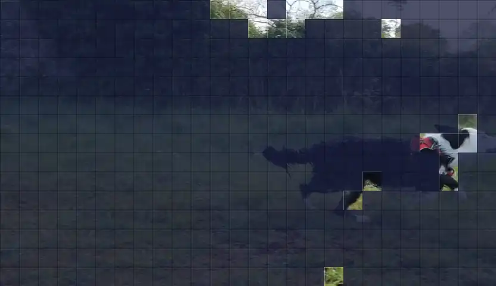
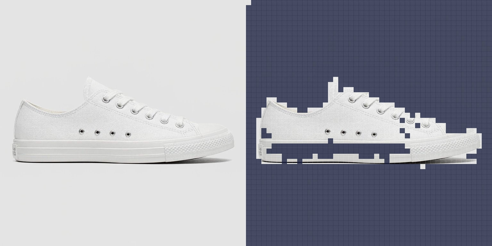

# Reusing codec pruning in your own model

Codec pruning is the core of CodecOPSD and the part you copy into another model. It decides, before the model runs,
which reference tokens to **drop**: it re-encodes each reference (picture or video) with H.264 and drops the tokens the
encoder spends neither motion nor residual on. Static backgrounds, flat areas and repeated content are dropped;
moving or detailed regions stay. It reads only pixels: no model, no training, no GPU, and it runs on the CPU while the
GPU encodes the same references with the VAE, so it adds no time.

Everything lives in `src/codecopsd/codec_gazer/` (one Python file, a C reader, an FFmpeg patch). Settings:
`src/codecopsd/configs/codec_gazer.yaml`. Full reference (every threshold, how it was chosen, speed):
`src/codecopsd/codec_gazer/README.md`.

## What to expect

Codec pruning keeps the tokens H.264 has to spend bits on and drops the rest. Below, on the 32 px token grid, the
dropped tokens are dimmed and the kept ones are shown as they are.

**Video**: the reference video of the bundled example `dog_frisbee`, 480 x 832, 119 frames, `drop_mask(video,
drop=0.7)`. 9,555 of its 13,650 tokens are dropped (70 %). Most of the grass, the sky and the houses go; the running
dog, the moving leaves and the new content right after each cut stay.



**Picture**: 1536 x 1536, `drop_mask(picture)` (left: the picture, right: its tokens). 1,911 of its 2,304 tokens are
dropped (83 %). The flat background goes; the shoe, its laces and its edges stay.



The model then reads only the kept tokens, each at its original position. With the CodecOPSD LoRA the output stays
close to the teacher that sees every token ([README, Visualization](../README.md#visualization)). Without the LoRA,
codec pruning already works in many cases, mostly on pictures (section 5).

## 0. Install, with the exact versions

Codec pruning has two halves, an H.264 encoder and a patched H.264 decoder. Both versions are pinned, because they decide
which tokens are dropped and the students were trained on exactly those masks.

| Half | What it is | Version | Pinned by |
|---|---|---|---|
| Encoder | x264 inside the static FFmpeg binary that the `imageio-ffmpeg` package ships | `imageio-ffmpeg` 0.7.0, which ships FFmpeg 7.0.2 (static, with libx264) | `pyproject.toml`: `imageio-ffmpeg==0.7.0` |
| Decoder (the reader) | the FFmpeg 5.1 H.264 decoder, patched to export the motion vectors, the luma residual and the skipped macroblocks, linked statically into the prebuilt package `codecopsd-codec` | FFmpeg 5.1 | `pyproject.toml`: `codecopsd-codec` 0.1.0, the wheel of the GitHub Release v0.1.0 |

Steps (Linux x86_64, Python 3.12):

```bash
pip install -e .                      # torch, numpy, imageio-ffmpeg 0.7.0, the reader (codecopsd-codec), ...
```

Check the install:

```bash
python -c "import imageio_ffmpeg as f; print(f.__version__, f.get_ffmpeg_version())"
# 0.7.0 7.0.2-static
python -c "import torch; from codecopsd.codec_gazer import drop_mask; print(tuple(drop_mask(torch.zeros(22, 3, 480, 832, dtype=torch.uint8)).shape))"
# (7, 15, 26)
```

Rules for the install:

- Encode with the FFmpeg of `imageio-ffmpeg` 0.7.0 (`codec.py` calls `imageio_ffmpeg.get_ffmpeg_exe()`), never with a
  system FFmpeg or another x264 build.
- Decode with the reader of `codecopsd-codec` only.

## 1. Get codec pruning running

After section 0:

```python
from codecopsd.codec_gazer import drop_mask

dropped = drop_mask(video)            # RGB video [T, 3, H, W], uint8 or float in [-1, 1] -> bool [T', H / 32, W / 32]
dropped = drop_mask(picture)          # RGB picture [3, H, W] -> bool [1, H / 32, W / 32]
dropped = drop_mask(video, drop=0.7)  # priority drop: 70 % of the video's tokens (recommended)
print(f"drop {dropped.float().mean():.0%}")
```

`True` = the token is dropped (`keep_mask` is its complement, which is what the pipelines index with). At least one
token of every reference is always kept.

## 2. Match your token grid

Codec pruning works on 16 x 16 macroblocks and reduces them to tokens of 32 x 32 pixels (2 x 2 macroblocks: a VAE with
spatial stride 16 and a patch size of 2, as MiniMax-H3 and Cosmos 3). In time it follows the VAE through `grid` =
(frames per token frame after the first, frames per VAE clip or `None`), and `frame_groups(num_frames, grid)` gives
the first pixel frame of every token frame:

| VAE | `grid` | Frames -> token frames |
|---|---|---|
| MiniMax-H3 (17-frame clips: 1 + 4 x 4 frames) | `MINIMAX_H3 = (4, 17)` | 17n + 5 -> 5n + 2 |
| Cosmos 3 and other 4x temporal VAEs (1 + 4n frames, no clip restart) | `COSMOS3 = (4, None)` | 4n + 1 -> n + 1 |

A height or width that is not a multiple of 32 is reflect-padded at the bottom / right (`to_rgb24`). A token's motion
is the largest motion vector over its pixels and frames, its residual the largest per-frame mean |luma residual|.
For a VAE whose tokens cover other sizes, change the 2 x 2 reduction in `_signals` (`codec.py`) and re-tune the
thresholds.

## 3. Run it in parallel with the VAE encode (default in every pipeline here)

```python
from concurrent.futures import ThreadPoolExecutor
from codecopsd.codec_gazer import MINIMAX_H3, submit_gaze

with ThreadPoolExecutor(len(references)) as pool:
    # 1. start codec pruning first: it quantizes on the GPU, copies uint8 frames to pinned host memory without waiting,
    #    and runs x264 + the reader in a CPU thread (both outside the Python interpreter lock)
    futures = [submit_gaze(pool, ref, kind="video", grid=MINIMAX_H3, drop=0.7) for ref in references]  # ref on the GPU
    # 2. meanwhile the GPU encodes the same references with the VAE
    latents = [vae.encode(ref) for ref in references]
    # 3. collect the masks (ready long before the VAE finishes)
    keeps = [f.result().keep for f in futures]
```

`submit_gaze` takes a reference already on its GPU (the VAE needs it there anyway) and returns a future of a `Gaze`
(`.keep`: the transformer's tokens; `.vlm_keep`: those of a text encoder that reads the references, see below). One
thread per reference. The masks are ready long before the reference VAE encode finishes, so the pipeline never waits
for them. In training, the DataLoader workers run it on each sample's references again the same way (`--live-gaze on`).

## 4. Drop the rows, keep the positions

Flatten each reference's latent tokens in (token frame, row, column) order, build the rotary positions of the full
dense sequence exactly as the released model does, then remove the dropped rows from both: the remaining rows keep
their original positions, so the model still sees where every token came from.

```python
rows, positions = patchify(latents), dense_rotary_positions(...)   # [N, C], [N, 3] for the N dense reference rows
keep = torch.cat([k.flatten() for k in keeps])                       # same order as the rows
rows, positions = rows[keep], positions[keep]
```

MiniMax-H3: `MiniMaxH3CodecOPSDPipeline.layout` (`pipelines/minimax_h3_ref2va/pipeline_minimax_h3_ref2va.py`) builds the
released packing with diffusers' `build_ref2va_packed_sequence` and leaves the dropped reference rows out without moving
the others. Text, generated and audio rows are never dropped.

If the model reads the references a second time through a vision-language encoder (MiniMax-H3's VLM text encoder), drop its
vision tokens too (`gaze(..., vlm=True).vlm_keep`, mapped onto the encoder's vision patches in
`pipelines/minimax_h3_ref2va/vlm_drop.py`; the dropped vision tokens are removed right before its language model, so the
kept ones keep their positions).

## 5. Training-free, or train a small adapter on the kept rows

Codec pruning needs no training. On a frozen model it already gives good results in many cases, especially on
pictures, so you can deploy it training-free: drop the rows (section 4) and run the model as released. With the
MiniMax pipelines here, that is a call without a LoRA and with `gaze=True`:

```python
pipe = MiniMaxH3ImageCodecOPSDPipeline.from_minimax_h3_image("MiniMax-H3-Image")   # no load_condition_lora
image = pipe(prompt, pictures, gaze=True).images[0]
```

To keep the teacher's quality at larger drops, train a LoRA that acts on the reference rows only
(`ReferenceRowLoRALinear` in `models/transformers/transformer_minimax_h3.py`), by on-policy distillation from the
same model with every token:

1. Encode the sample once: text embeddings (teacher: every vision token; student: the dropped ones removed), reference
   latents, codec pruning masks.
2. Draw a step k. The student (LoRA on, kept rows) takes k sampler steps from noise without gradients: the state is the
   student's own.
3. Teacher velocity at that state: the same weights, LoRA off, every reference row. Student velocity with gradients.
4. Loss = MSE between the two over the generated rows. No ground-truth video is needed.

`scripts/train_minimax_h3_ref2va.py` is the whole loop ([docs/training.md](training.md)).

## 6. Check your port

- Masks bit for bit: compare `drop_mask` of your references with this repository's on several sizes and lengths, also
  on a machine with few CPU cores (x264's decisions depend on its thread count, which `codec.py` pins).
- Never change the x264 settings, its thread count, the FFmpeg patch or the token decision for speed: each changes
  which tokens are dropped, and the student is trained on exactly those.
- Look at the dropped tokens on a few references (the demos, `python app.py`, draw them) before training.
